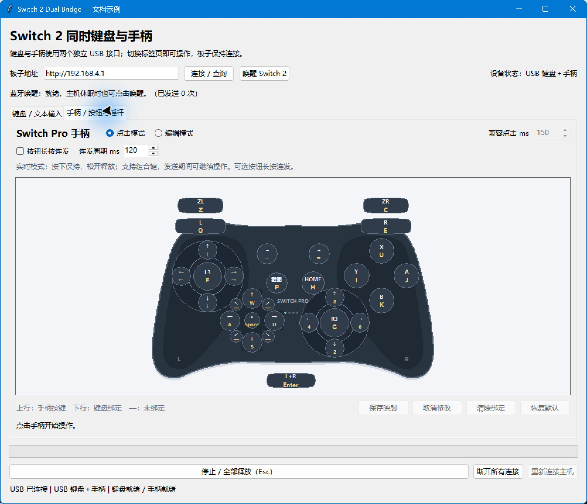
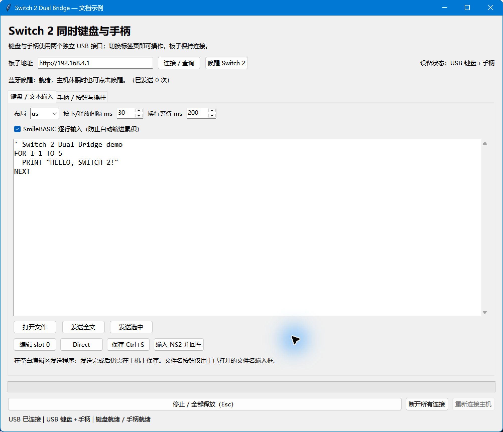
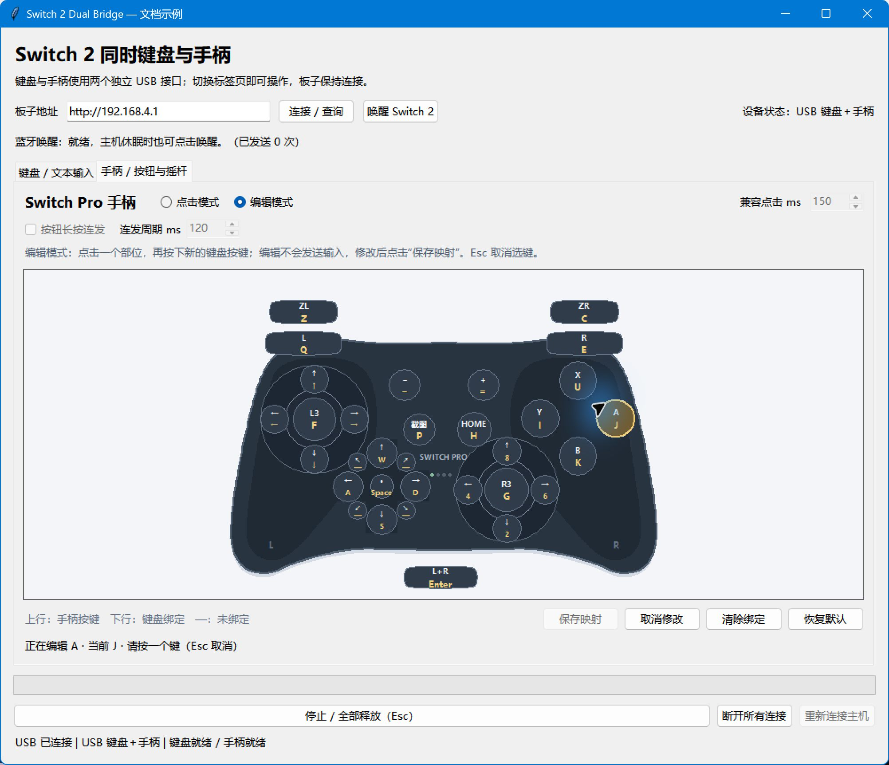

# Switch 2 Dual Bridge

通过 **ESP32-S3** 为 Switch 2 同时提供 USB 键盘和手柄。电脑使用 Python 桌面客户端，通过 Wi-Fi 输入文本、操作手柄、编辑键位，并管理 USB 连接与 BLE 唤醒。



*界面截图使用示例配置与示例文本。*

## 功能

- **双 USB HID 接口**：键盘和手柄同时连接，切换标签页即可使用。
- **文本输入**：支持 ASCII、Tab、换行、US/JIS 布局和 SmileBASIC 逐行输入。
- **实时手柄**：按下保持、松开释放，支持组合键、双摇杆和可选长按连发。
- **自定义键位**：在手柄图上编辑电脑键盘映射，保存后立即生效。
- **连接管理**：停止并释放输入、断开或恢复 USB，以及可配置的 BLE 唤醒广播。
- **Windows 桌面启动**：无常驻控制台，错误日志自动轮转。

## 硬件与环境

| 项目 | 要求 |
|---|---|
| 开发板 | ESP32-S3，16 MB Flash |
| USB | 板子原生 USB 口通过数据线连接 Switch 2 底座 USB-A 口 |
| 主机设置 | 开启 Nintendo Switch Pro 手柄的有线通信 |
| 网络 | 电脑与板子处于同一局域网，或电脑连接板子热点 |
| 客户端 | Python 3.12，包含 Tkinter；仅使用标准库 |
| 固件 | `dual-1.3.0` 或以上，支持实时输入协议 |
| 构建工具 | Arduino IDE / Arduino CLI，Arduino ESP32 core **3.3.7** |

固件配置为 DIO、USB OTG、CDC 关闭、PSRAM 关闭，BLE 使用 ESP32 支持包内置 NimBLE。BLE 仅用于唤醒广播；本项目不提供蓝牙手柄输入、体感、震动、NFC 或 C/GL/GR 按键。

## 首次配置

复制配置示例：

```powershell
Copy-Item client-config.example.json client-config.json
Copy-Item firmware/Switch2Dual/secrets.example.h firmware/Switch2Dual/secrets.h
Copy-Item firmware/Switch2Dual/WakeConfig.example.h firmware/Switch2Dual/WakeConfig.h
```

1. 在 `secrets.h` 设置热点名称、至少 8 位的热点密码和随机 API 密钥。
2. 在 `client-config.json` 填写相同的 `api_key`，并将 `url` 设置为板子地址。热点模式默认地址为 `http://192.168.4.1`。
3. 使用 BLE 唤醒时，在 `WakeConfig.h` 填写自己设备的蓝牙地址和完整 31 字节原始广播数据。全零示例值不能唤醒设备。
4. 编译并刷入固件，再启动客户端。

本地密钥、Wi-Fi 密码、唤醒参数、草稿及固件二进制均不随仓库分发，相关文件已加入 `.gitignore`。HTTP API 适用于可信局域网，不应暴露到互联网。

## 编译与刷写

在项目目录执行：

```powershell
powershell -NoProfile -ExecutionPolicy Bypass -File .\build.ps1
```

脚本使用 Windows Arduino IDE 所附 CLI，将固件写入 `binaries/`。

将板子的原生 USB 口连接电脑，按住 BOOT，短按 RESET/EN，再松开 BOOT。确认下载串口和目标板 MAC 后执行：

```powershell
python -m pip install esptool
powershell -NoProfile -ExecutionPolicy Bypass -File .\flash.ps1 -Port COM11 -ExpectedMac 'AA:BB:CC:DD:EE:FF'
```

把串口与 MAC 替换为自己的设备值。也可复制 `flash.example.json` 为 `flash.local.json` 并填写 MAC，之后只传 `-Port`。脚本校验目标 MAC 后才写入固件；刷写后若仍处于下载模式，松开 BOOT，再按一次 RESET/EN。

## 启动与连接

1. 将板子原生 USB 口接到 Switch 2 底座，并唤醒主机。
2. 双击 **`start-dual.cmd`** 启动无控制台界面；也可执行 `python remote.py`。
3. 填写板子地址，点击“连接 / 查询”，等待键盘和手柄就绪。

首次 USB 枚举后约有一秒稳定等待。连接异常时，检查数据线、原生 USB 端口及主机的有线手柄设置。启动错误与界面异常记录在 `remote-errors.log`。

## 键盘与文本输入



支持每次 1–16384 个 ASCII 字符、Tab 和换行，可打开文件、发送全文或仅发送选中内容。默认按下和释放各等待 30 ms，换行额外等待 200 ms；漏字时可适当增加等待。

- **SmileBASIC 空白程序编辑区**：启用“逐行输入”，保留源码缩进，避免自动缩进累积。
- **普通输入框、文件名或 Direct 控制台**：取消“逐行输入”。
- **快捷操作**：编辑 slot 0、进入 Direct、保存 Ctrl+S，以及在文件名输入框中输入 NS2 并回车。

发送正文前会检查并关闭 CapsLock。关闭窗口会保存电脑端草稿到 `last-draft.txt`；主机中的程序仍需在主机上保存。

## 手柄操作

先点击手柄区域获取键盘焦点，再使用图中标注的电脑按键；也可用鼠标按住对应部位。按下保持、松开释放，支持按钮与摇杆组合；相反方向同时按下时回中。

发送由独立后台线程处理，输入期间仍可继续操作。快速短按的按下与释放顺序会被保留，实际响应速度取决于 Wi-Fi、USB 与主机处理速度。

勾选 **“按钮长按连发”** 后，当前按住的按钮按周期交替按下、释放。默认周期为 120 ms，可设置为 50–1000 ms；十字键和摇杆保持持续输入。实时模式不使用“兼容点击 ms”参数。

### 默认键位

| 手柄操作 | 电脑键位 |
|---|---|
| A / B / X / Y | J / K / U / I |
| L / R / ZL / ZR | Q / E / Z / C |
| 十字键上 / 下 / 左 / 右 | W / S / A / D |
| 左摇杆四方向 | 方向键 |
| 右摇杆上 / 下 / 左 / 右 | 8 / 2 / 4 / 6 |
| L3 / R3 | F / G |
| − / ＋ / HOME / 截图 | - / = / H / P |
| 回中 / L+R | Space / Enter |

### 自定义映射



进入“编辑模式”，点击手柄部位，再按新的电脑按键，最后点击“保存映射”。同一个电脑键只能绑定一个部位，映射保存在 `gamepad-keymap.json`；编辑过程不会向主机发送输入。

字母不区分大小写。支持数字、方向键、功能键和常用单键；Ctrl/Alt 组合键不用于映射。编辑模式中的 Esc 取消当前选键。

## 停止、连接与唤醒

| 操作 | 行为 |
|---|---|
| Esc / 停止并全部释放 | 清空待发送操作、释放键盘和手柄，并停止唤醒广播 |
| 切换标签页、进入编辑模式或手柄区域失去焦点 | 提交手柄释放 |
| 断开所有连接 | 释放输入、断开 USB 并停止广播，保留 Wi-Fi 与 HTTP |
| 重新连接主机 | 恢复 USB 枚举 |
| 唤醒 Switch 2 | 使用已配置参数发送一次 1 秒 BLE 广播 |

断流约 600 ms 后，固件自动清空队列并回中；积压或过期的输入不会在恢复连接后补放。USB 主机停止接收时，物理释放报告需等通信恢复后才能送达。

唤醒广播发送成功不代表主机已经醒来，以主机画面和 USB 状态为准。超时后先查询状态，避免重复执行尚未确认的操作。

## 命令行

```powershell
python remote.py status
python remote.py text 'Aa09'
python remote.py pulse --buttons A --hold 150
python remote.py pulse --buttons L+R --hold 300
python remote.py pulse --dpad UP --hold 150
python remote.py pulse --lx 255 --hold 200
python remote.py wake
python remote.py cancel
python remote.py disconnect
python remote.py connect
```

指定地址示例：`python remote.py --url http://192.168.4.1 status`。运行命令行 `pulse` 前，先在 GUI 停止实时手柄输入。

## 开发

运行客户端协议与 Windows GUI 测试：

```powershell
python -X utf8 -B -m unittest discover -s tests -v
```

在 Visual Studio 开发人员命令提示符中验证固件队列逻辑：

```bat
mkdir work
cl /EHsc /std:c++17 tests/test_pad_stream.cpp /Fe:work/test_pad_stream.exe /Fo:work/test_pad_stream.obj
work\test_pad_stream.exe
```

HTTP 接口、状态字段及实时输入协议见 [协议文档](docs/protocol.md)。

| 路径 | 用途 |
|---|---|
| `remote.py` | GUI、命令行与设备管理 |
| `pro_controller.py` | 手柄图与键位编辑 |
| `client.py`、`controller.py` | 键盘与手柄通信 |
| `pad_stream.py` | 后台发送队列、续租与故障处理 |
| `firmware/Switch2Dual/` | 双 USB HID 与 BLE 固件 |
| `tests/` | 协议、界面与固件队列测试 |
| `build.ps1`、`flash.ps1` | 构建与目标校验刷写 |

第三方手柄描述符的 MIT 许可保留在 `SwitchDescriptor.h`，TinyUSB 许可见 `TINYUSB-LICENSE.txt`。本项目与 Nintendo 无隶属关系。
